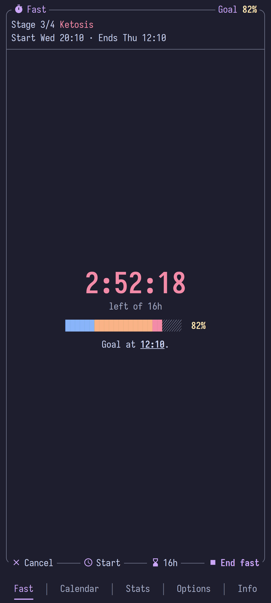
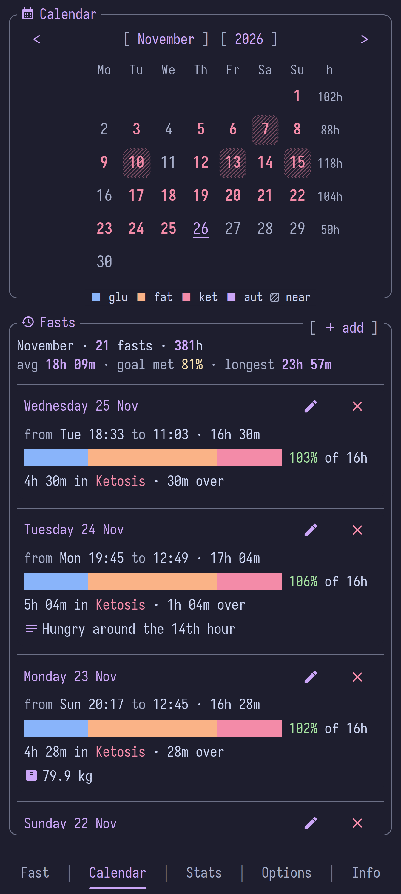
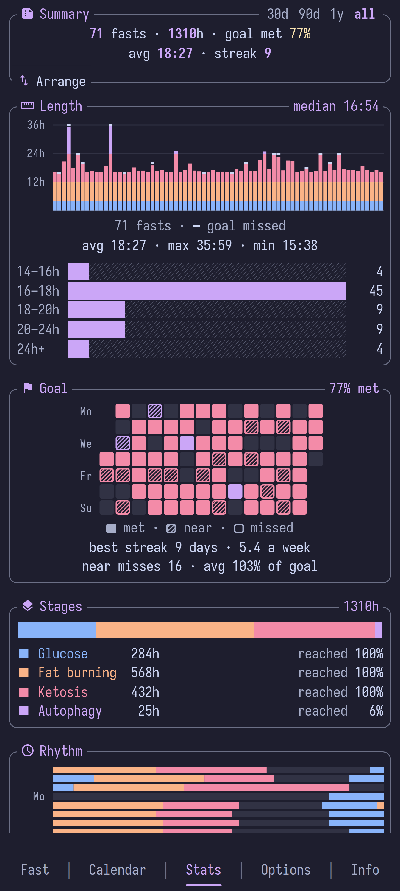
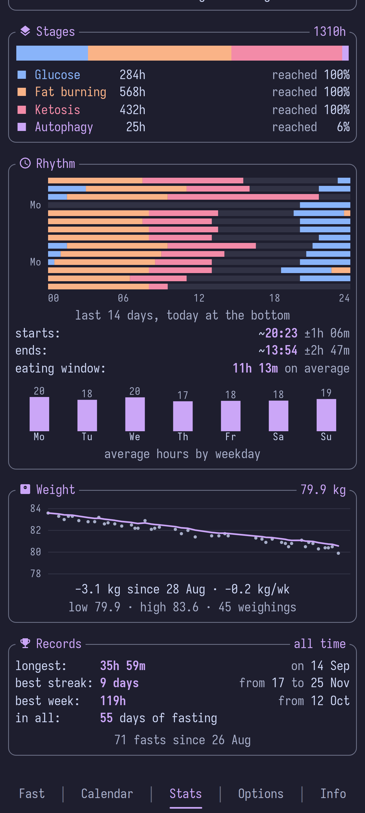
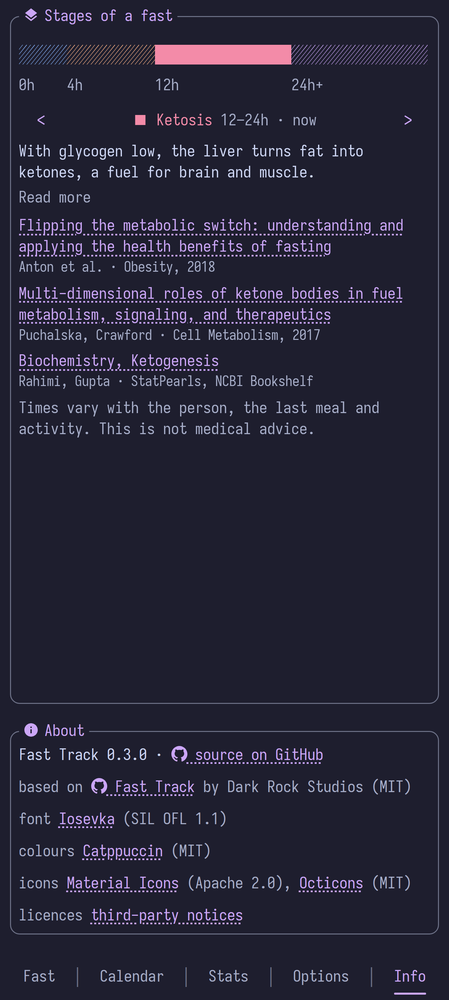
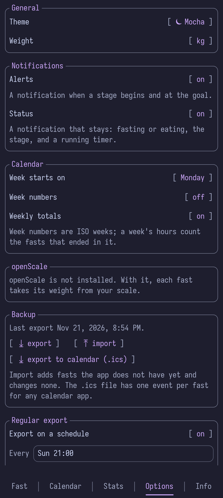
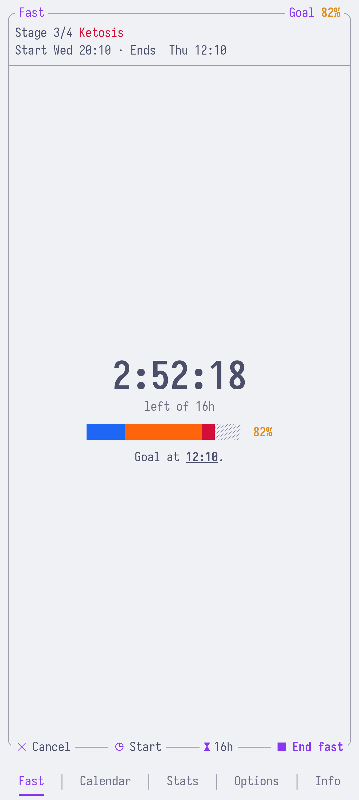

# Fast Track

An offline intermittent-fasting tracker for Android, drawn like a terminal.

[](https://github.com/nouritsu/fast-track/actions/workflows/ci.yml)
[](https://github.com/nouritsu/fast-track/releases/latest)
[](LICENSE)

## About

- **Fasts**: start one now, earlier or later, with a goal of 12 to 24 hours by the hour, or 30, 36, 42, 48, 60 or 72.
- **Timer**: shows the time left or elapsed (tap to switch), and counts on past the goal. Resume a fast ended by mistake, or discard one started by mistake.
- **Stages**: Glucose, Fat burning, Ketosis and Autophagy, on a progress line in their colours, with when the next one comes.
- **Notifications**: an alert when a stage begins and at the goal (or at the goal only), a reminder when the eating window closes, and an ongoing status notification with a running timer and the stages as a bar, a Live Update on Android 16 that a swipe can't clear. They all work with the app closed.
- **Calendar**: each day coloured by the deepest stage its fast reached, with ISO week numbers and weekly totals. Each fast shows its progress to the goal, its time in the deepest stage and how far past the goal it went. Tap any day to log or plan a fast on it; edit or delete fasts, with undo.
- **Stats**: over 30 days, 90 days, a year, all time or any range of days. Covers fast lengths, goal streaks, time in each stage, your daily rhythm, weight trend and records, in the order you choose. Tap or drag across a chart to read its exact values.
- **Weight**: in kg or lb, typed in or taken from [openScale](https://github.com/oliexdev/openScale), with BMI once you add your height.
- **Your data**: export and import JSON backups (a file a day, or one file kept up to date), export an `.ics` calendar, and schedule regular exports.
- **Info**: what happens in each stage, with the papers to read. Not medical advice.
- **Looks**: [Catppuccin](https://catppuccin.com) Mocha or Latte, or whichever your phone is in, with the accent and stage colours you pick; the Iosevka font, boxes drawn with lines, Material icons.
- **Your way**: reorder or hide the tabs and pick the one the app opens on; set the text size, motion, haptics and a 12- or 24-hour clock, or let them follow the phone.
- **Private**: no network permission, no account, no ads, no analytics.

## Showcase

| Fast | Calendar | Stats | Trends |
| :-: | :-: | :-: | :-: |
|  |  |  |  |

| Info | Options | Latte |
| :-: | :-: | :-: |
|  |  |  |

## Installation

### F-Droid repository

Open [fdroid.nouritsu.com](https://fdroid.nouritsu.com) on your phone and tap **Add to F-Droid**, or scan its QR code. To add it by hand in F-Droid, Droid-ify or Neo Store, use:

- Address: `https://fdroid.nouritsu.com/repo`
- Fingerprint: `1C7F39DD34C841BE845D3B47EF5A5FB3CBDB9A28748D8862183AB0FEC867E971`

Updates then arrive like any other app's.

### GitHub releases

Download `fast-track-<version>.apk` from the [latest release](https://github.com/nouritsu/fast-track/releases/latest), then check it with either of:

```sh
sha256sum -c SHA256SUMS
gh attestation verify fast-track-<version>.apk --repo nouritsu/fast-track
```

The APK is signed with certificate SHA-256 `88d04121c1abf9be4278f78f90cb58cfaef42521e7e177b1e5c97c1d6c3216c5`, the same key as the F-Droid repo's APKs, so you can switch between the two.

### Build from source

The build needs [Nix](https://nixos.org/download) with flakes. The APK builds on x86_64 Linux; the web app and the dev shell also work on aarch64 Linux and Apple Silicon Macs.

```sh
git clone https://github.com/nouritsu/fast-track
cd fast-track
nix build .#apk               # unsigned APK in result/
nix run .#apk -- --install    # sign with your debug key, then adb install
nix run .#apk-debug -- --install  # the same, as Fast Track (debug) beside the release app
```

A build signed with your own key can't update one from a release, and the reverse is also true. Export your fasts (Options → Backup) and uninstall before switching, or install the debug build, which has its own id and storage and sits beside the release app.

To work on the app:

- `nix develop --no-pure-eval`, or `direnv allow`, enters the dev shell.
- `nix build .#app-assets -o app/public/generated` builds the fonts and icons.
- `cd app && npm ci && npm run dev` runs it in a browser.
- `nix flake check --no-pure-eval` runs everything CI runs.

## Privacy and permissions

Your fasts stay on the phone. The app can't go online, and nothing leaves the phone unless you export it. Android's cloud backup skips the app's data unless you turn it on in **Options → Privacy**. A direct transfer to a new phone carries the data either way (needs Android 9+). On the lock screen, the status notification follows your phone's setting for sensitive content.

| Permission | Why |
| --- | --- |
| `POST_NOTIFICATIONS` | Stage alerts and the status notification |
| `POST_PROMOTED_NOTIFICATIONS` | The status notification as a chip in the status bar on Android 16 and newer; switch it off for the app in Android's settings |
| `SCHEDULE_EXACT_ALARM` | Status updates and regular exports on time; without it they run a little late |
| `RECEIVE_BOOT_COMPLETED` | Sets those alarms again after a restart |
| `WAKE_LOCK` | Brought in by Capacitor's notification plugin, for scheduled notifications |
| `VIBRATE` | Haptic feedback |
| `WRITE_EXTERNAL_STORAGE` | Exports to `Documents/FastTrack/` on Android 10 and older |
| `com.health.openscale.READ_WRITE_DATA` | Reads weighings from openScale, only if you connect it |

## Attributions

- Based on [Fast Track](https://github.com/Darkrock-Studios/FastTrack) by Dark Rock Studios (MIT).
- Colours: [Catppuccin](https://github.com/catppuccin/catppuccin) Mocha and Latte (MIT).
- Font: [Iosevka](https://github.com/be5invis/Iosevka) (SIL OFL 1.1).
- Icons: [Material Icons](https://fonts.google.com/icons) (Apache-2.0) and [Octicons](https://primer.style/octicons) (MIT).
- Built with [Svelte](https://svelte.dev) and [Capacitor](https://capacitorjs.com).

[THIRD_PARTY_NOTICES.md](THIRD_PARTY_NOTICES.md) lists everything the app bundles. The app shows the same list under Info → licences.

## License

[GPL-3.0-or-later](LICENSE).
